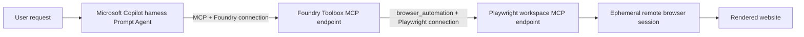

# Browser Automation Blog Research

A Microsoft Copilot harness Prompt Agent that uses a Foundry Browser Automation Toolbox to inspect the
rendered Microsoft Foundry developer blog. The sample intentionally uses azd instead of relying on
the Portal tool picker.

## What this demonstrates

One `azd up` creates:

- a fresh Microsoft Foundry account, project, and sample-specific GPT-5.4 Global Standard deployment;
- a Playwright workspace with local access-token authentication disabled;
- workspace-scoped `Playwright Workspace Contributor` access for the Foundry project identity;
- a secretless `PlaywrightWorkspace` project connection to the workspace's remote MCP endpoint;
- a Toolbox containing the GA `browser_automation` tool;
- a same-project RemoteTool connection to the Toolbox MCP endpoint; and
- a Prompt Agent using `harness.type: microsoft_copilot_preview` with every harness-native built-in
  disabled.

The agent must create a managed browser session, inspect the rendered page, and close the session.
It has no Web Search, shell, direct HTTP, local-browser, or arbitrary browser-code capability.

## Architecture in detail

### Playwright workspace

`PW` is shorthand for Playwright. A Playwright workspace is the Azure resource
`Microsoft.LoadTestService/playwrightWorkspaces`; it is not a local folder and it does not run the
agent. It is the service boundary that owns access control, regional browser capacity, and ephemeral
remote browser sessions.

The workspace is provisioned in a Browser Automation-supported region, which can differ from the
Foundry project region. Its Azure resource returns a workspace ID and a data-plane URI. The sample
converts that URI into the workspace-scoped remote MCP endpoint:

```text
https://<region>.mcp.playwright.microsoft.com/playwrightworkspaces/<workspace-id>/mcp
```

That endpoint implements Model Context Protocol over Streamable HTTP. It exposes operations such as
creating a browser session, navigating, reading an accessibility snapshot, finding page content,
and closing the session. Each browser operation after creation carries the returned
`browserSessionId`.

The default sample authenticates the Foundry project identity to this endpoint:

- the Playwright workspace has local access-token authentication disabled;
- the Foundry project managed identity receives `Playwright Workspace Contributor` only on that
  workspace resource; and
- the Foundry `PlaywrightWorkspace` connection stores the MCP endpoint and audience
  `https://mcp.playwright.microsoft.com`, but no secret.

### Browser Automation Toolbox

The Browser Automation Toolbox is a versioned Foundry resource inside the Foundry project. Toolbox
version 1 contains one GA `browser_automation` entry that references the `PlaywrightWorkspace`
project connection. The Toolbox discovers the operations exposed by the Playwright MCP endpoint and
publishes them under namespaced names such as:

```text
browser___create_browser_session
browser___browser_navigate
browser___browser_snapshot
browser___browser_find
browser___close_browser_session
```

The Toolbox has its own MCP endpoint, separate from the Playwright MCP endpoint:

```text
https://<foundry-account>.services.ai.azure.com/api/projects/<project>/toolboxes/
browser-automation-toolbox/versions/1/mcp?api-version=v1
```

The Copilot harness Prompt Agent connects to this Foundry Toolbox endpoint through a
`RemoteTool` project connection. That outer connection uses a user Entra token with audience
`https://ai.azure.com`. The Agent never receives the Playwright credential directly.



### Runtime sequence

1. The Copilot harness Agent calls the Foundry Toolbox operation
  `browser___create_browser_session`.
2. The Toolbox invokes the Playwright workspace MCP server and returns a `browserSessionId`.
3. The Agent reuses that ID for `browser___browser_navigate` and
   `browser___browser_snapshot` or `browser___browser_find`.
4. The Toolbox forwards each call to the same managed browser session.
5. The Agent calls `browser___close_browser_session`, which releases the remote browser.

There are therefore two project connections and two MCP boundaries:

| Boundary | Project connection | Purpose |
| --- | --- | --- |
| Foundry Toolbox -> Playwright workspace | `BrowserAutomationBlog` (`PlaywrightWorkspace`) | Authenticates browser-session operations at the workspace MCP endpoint |
| Copilot harness Agent -> Foundry Toolbox | `BrowserAutomationToolbox` (`RemoteTool`) | Makes the versioned Toolbox operations available to the Agent |

### Direct Agent attachment

Foundry also supports adding Browser Automation directly to a Copilot harness Prompt Agent,
without a customer-created Toolbox. In that path the Browser Automation dialog creates or selects a
`PlaywrightWorkspace` project connection and saves this first-class tool entry on the Agent:

```yaml
tools:
  - type: browser_automation
    browser_automation:
      connection:
        project_connection_id: <playwright-workspace-connection>
```

This is not saved as `type: mcp`, and it does not reference a customer-visible Toolbox. The Foundry
runtime still implements the GA tool by connecting to the Playwright workspace's remote MCP server.
In other words, BAT is both:

- a first-class Foundry tool contract and Portal experience; and
- an MCP-backed runtime integration with the managed Playwright browser service.

The first-class layer adds typed configuration, connection validation, authentication choices,
session semantics, specialized UI, and stable Foundry tool/event identities. The underlying browser
engine and operations are served by Playwright Workspaces rather than running inside the Agent.

## Portal behavior

Portal availability depends on the selected region, model, project, and current product rollout. A
missing Portal tile does not by itself establish that the runtime rejects Browser Automation. This
sample exercises the deployable service path directly through a Browser Automation Toolbox backed
by a Playwright workspace.

The agent declares an authenticated Toolbox MCP connection explicitly. Its `uses:` dependencies
establish deployment order; the explicit MCP entry configures access to the Toolbox.

The Toolbox namespaces the inner BAT operations as `browser___<operation>`. The outer MCP
`allowed_tools` list must use those published names, such as
`browser___create_browser_session`; unprefixed names fail MCP initialization with
`INVALID_ALLOWED_TOOLS`.

## Prerequisites

- Azure Developer CLI 1.36.0 or later
- The Microsoft Foundry azd extension pack. The sample pins `azure.ai.agents` 1.0.0-beta.21
  and `azure.ai.projects` 1.0.0-beta.14.
- Azure CLI authenticated to the target tenant
- A subscription enabled for the `microsoft_copilot_preview` Prompt Agent harness
- Permission to create Foundry and Playwright workspace resources and
  `Microsoft.Authorization/roleAssignments/write`
- At least 1,000 GPT-5.4 Global Standard capacity units in the selected Foundry region. The sample
  requests that capacity and incurs model usage charges while deployed.

The Foundry project defaults to Canada Central and must use a region where the Copilot
harness is enabled for the selected subscription. The Playwright workspace separately defaults to
East US through `PLAYWRIGHT_LOCATION`, which must be a Browser Automation region. Browser Automation
is currently documented in `australiaeast`,
`eastasia`, `eastus`, `japaneast`, `switzerlandnorth`, `westeurope`, and `westus3`.

The default configuration uses Foundry in `canadacentral` and Playwright in `eastus`. Keeping the
locations separate matters when the two services don't have an enabled region in common for your
subscription.

## Deploy

From this folder:

```bash
azd auth login
azd env new browser-automation-blog-dev \
  --subscription <subscription-id> \
  --location canadacentral
azd up --no-prompt
```

To override the Playwright workspace region, run
`azd env set PLAYWRIGHT_LOCATION <supported-region>` before `azd up`. To override the Foundry region,
replace `canadacentral` in `azd env new`.

The deployment uses project managed identity. It does not generate, persist, or prompt for a
Playwright access token.

If Agent creation returns HTTP 403 saying `microsoft_copilot_preview` isn't enabled, select a Foundry
region where the harness is enabled for that subscription; changing only the Playwright region does
not grant harness entitlement. If deployment reports
`Microsoft.Authorization/roleAssignments/write`, use a subscription where you can assign
**Playwright Workspace Contributor**, or ask an administrator to deploy the sample.

## Test

Invoke the deployed agent in a fresh Conversation:

```bash
azd ai agent invoke browser-automation-blog-research \
  "$(cat prompts/blog-summary.md)" \
  --new-conversation \
  --timeout 1800 \
  --no-prompt
```

A successful response includes the rendered page title, three article links found on the page, and
the requested page-structure description. The article titles will change as the blog is updated.
Treat the browser tool calls, not prose alone, as proof that BAT ran.

## Known limitation

If `azd ai agent invoke --output raw` fails to resolve the Toolbox connection, use the normal
invocation command shown above.

Browser sessions are stateful and expire after inactivity. The instructions require a single session
ID to be reused for the whole task and explicitly closed even when extraction fails.

## Tear down

Delete the complete isolated environment after testing:

```bash
azd down --purge --force --no-prompt
```

## References

- [Browser Automation Tool](https://learn.microsoft.com/azure/foundry/agents/how-to/tools/browser-automation)
- [Playwright Workspaces remote MCP server](https://learn.microsoft.com/azure/app-testing/playwright-cloud-browsers/how-to-playwright-workspaces-remote-mcp)
- [Playwright workspace Bicep resource](https://learn.microsoft.com/azure/templates/microsoft.loadtestservice/2025-09-01/playwrightworkspaces)
