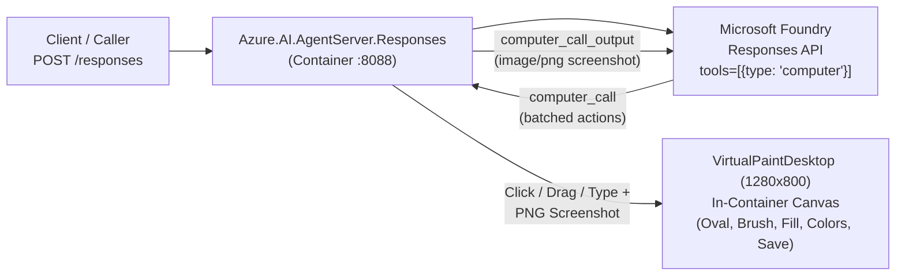

> [!IMPORTANT]
> This sample is for educational and demonstration purposes only and is not intended for production deployments. Before using this code in your own projects, review the dependencies, configuration, and security controls to ensure they meet your organization's requirements.
>
> Key considerations:
> - **Dependencies:** Ensure all libraries are updated to the latest stable, security-patched versions.
> - **Credentials:** Never hard-code secrets or connection strings; use environment variables or a managed secret store (e.g., Azure Key Vault).
> - **Authentication:** DefaultAzureCredential is used for convenience; in production, scope credentials to the minimum required identity (e.g., ManagedIdentityCredential).
> - **Network & Access Control:** Review endpoint exposure, CORS settings, and role assignments before deploying to shared or public environments.
> - **Desktop Automation:** The OpenAI Computer Tool executes mouse and keyboard actions inside the container's virtual desktop (or local desktop). Always run inside an isolated container or VM.

# OpenAI Computer Tool Hosted Agent (`kind: hosted`, C# / .NET)

This sample demonstrates how to build, run locally, and deploy a **C# Microsoft Foundry Hosted Agent** (`kind: hosted`, `protocol: responses`) that uses the **GA OpenAI Computer Tool** (`ComputerTool` / `{"type": "computer"}`) together with an **in-container `1280x800` Virtual Paint Desktop** (pure managed C# framebuffer + PNG encoder, no Playwright or native GUI libraries required).

---

## Architecture (`kind: hosted` vs Prompt Agent)

Unlike a Prompt Agent where your local client runs the `computer_call` loop against your local desktop, a **Hosted Agent** runs the entire agent loop **inside a managed container** (`Azure.AI.AgentServer.Responses` on port `8088`):



1. The caller sends a single `POST /responses` request (for example, `"paint_smiley"` or `"/verbose paint_smiley"`) to the Hosted Agent container.
2. Inside the container, `ComputerToolHandler` (`ResponseHandler`) opens a clean `1280x800` `VirtualPaintDesktop` with toolbar buttons (`Oval`, `Brush`, `Fill`, `Yellow`, `Black`, `Blue`, `Red`, `Green`, `Clear`, `Save`).
3. The container calls the Microsoft Foundry Responses API with `"tools": [{"type": "computer"}]`, executes every `computer_call` action (`click`, `double_click`, `move`, `drag`, `scroll`, `type`, `keypress`, `wait`, `screenshot`), encodes a `1280x800` PNG screenshot in pure managed C#, and returns the final response once the smiley face is drawn and saved to `paint_smiley_<timestamp>.png`.

---

## Project Structure

```text
openai-computer-tool/
├── README.md
├── AGENTS.md
├── azure.yaml
├── sample.yaml
└── src/
    └── openai-computer-tool-dotnet-responses/
        ├── Dockerfile
        ├── .dockerignore
        ├── .gitignore
        ├── .env.example
        ├── openai-computer-tool.csproj
        ├── Program.cs                        # ResponsesServer (:8088) + --local CLI mode
        ├── prompts/
        │   └── base.md                       # System instructions for the Computer Tool agent
        ├── scenarios/
        │   └── PaintSmileyScenario.cs        # Paint Smiley scenario prompt and runner
        └── utils/
            ├── AgentRunner.cs                # Multi-turn GA OpenAI Computer Tool loop
            ├── VirtualPaintDesktop.cs        # 1280x800 in-container Virtual Paint Desktop + PNG encoder
            └── Settings.cs                   # Environment configuration loader
```

---

## Prerequisites

1. **.NET 8.0 SDK** (or newer, such as .NET 9.0 / 10.0 SDK)
2. **Azure CLI (`az`)** and **Azure Developer CLI (`azd`)** with the `azure.ai.agents` extension (`>=1.0.0-beta.16`)
3. A **Microsoft Foundry Project** with a computer-use capable model deployment (such as `gpt-5.4` or newer) and RBAC role **Azure AI User** assigned to your identity (`az login`).

---

## Configuration

Copy `.env.example` to `.env` inside `src/openai-computer-tool-dotnet-responses/`:

```bash
cp src/openai-computer-tool-dotnet-responses/.env.example src/openai-computer-tool-dotnet-responses/.env
```

Edit `src/openai-computer-tool-dotnet-responses/.env`:

```dotenv
PROJECT_ENDPOINT=https://<your-foundry-resource>.services.ai.azure.com/api/projects/<your-project>
MODEL_DEPLOYMENT_NAME=gpt-5.4
```

*(Both `PROJECT_ENDPOINT` / `FOUNDRY_PROJECT_ENDPOINT` and `MODEL_DEPLOYMENT_NAME` / `AZURE_AI_MODEL_DEPLOYMENT_NAME` are supported.)*

---

## Running Locally

### Option 1: Start the Hosted Agent Server (`http://localhost:8088/responses`)

```bash
cd src/openai-computer-tool-dotnet-responses
dotnet run
```

In a second terminal, invoke the `/responses` endpoint (include `/verbose` in the input to receive a turn-by-turn breakdown of every `computer_call` action):

```bash
curl -sS -X POST http://localhost:8088/responses \
  -H "Content-Type: application/json" \
  -d '{"input": "/verbose paint_smiley"}'
```

### Option 2: Direct CLI Mode (`--local`)

Run the Paint Smiley scenario directly from the command line without starting the HTTP server:

```bash
cd src/openai-computer-tool-dotnet-responses
dotnet run -- --local paint_smiley
```

---

## Deploying to Microsoft Foundry (`azd`)

From `samples/csharp/hosted-agents/bring-your-own/responses/openai-computer-tool/`:

```bash
azd init -t microsoft-foundry/foundry-samples/samples/csharp/hosted-agents/bring-your-own/responses/openai-computer-tool
azd ai agent run
azd deploy
azd ai agent invoke "paint_smiley"
```
