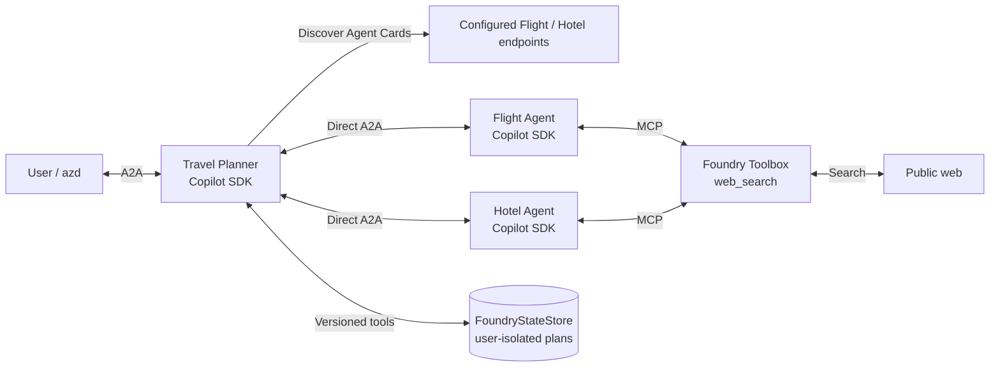
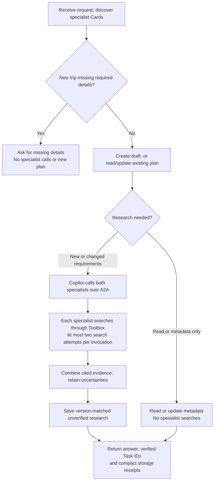

# What this sample demonstrates

Three **Copilot SDK** agents collaborate over **native A2A 1.0** to research
flights and hotels using **Foundry Toolbox web search**, instead of embedded
inventory. The planner saves cited research, requirements, metadata and history
in user-isolated **FoundryStateStore**.

This sample is research, **not a booking engine or guaranteed live-price search**.

## How it works

### Component block diagram



### Request flow



The planner discovers Cards before its model loop. Copilot selects specialists
and composes their messages; the native A2A SDK handles transport. Only successful
completed Tasks with nonempty results count as evidence. There is no Toolbox A2A
delegation: **only the specialists use the web-search toolbox**.

Each specialist exposes just the configured `web_search` MCP tool through the
Copilot SDK. A native pre-tool hook permits **at most two search attempts per
specialist invocation**. Tool requests time out after 60 seconds; specialist
model loops after 180 seconds, below the planner's 240-second specialist HTTP
timeout. Coding, filesystem and shell tools are not enabled.

The `web-search` specialist artifact records actual search call IDs, success
and returned source URLs. Model-only success is rejected if no successful search
with source URLs occurred. The planner returns compact `specialist-calls`
receipts containing tool, agent and Task ID, plus `trip-state` receipts containing
operation names and plan ID/version/revision/status/history-count summaries.
It does not repeat full specialist answers, requirements, metadata, recommendation
text, history or ETags in these artifacts. Full records remain in storage and
available to the model's tools; explicit history requests still retrieve full
history. Ordinary show-plan requests are instructed to use `get_plan` alone.
Both `--output default` and `--output raw` contain the same compact artifacts;
raw output exposes the complete A2A envelope, not an expanded record dump.
The readable answer also includes a Python-generated **Verified task IDs (this
request)** section, listing the planner's Task ID and every completed specialist
call ID, including repeated calls. Requests without delegation explicitly say no
specialists were called. This list appears with both `--output default` and
`--output raw`, independently of what the model repeats in its answer.
W3C propagation and the planner's callback-context repair are retained; this does
not guarantee complete span nesting in every telemetry UI.

### Research, not verified inventory

- Search can establish route/property information and provide source links.
  Exact-date fares, full-stay prices, taxes, availability, occupancy, cancellation
  terms and distances may remain **unverified**.
- General refund policies and advertised "from" prices do not establish that a
  particular itinerary is refundable or fits the budget. Missing results do not
  prove no inventory exists.
- Recommendations can only be saved as **`unverified`**, never `ready` or
  `no_match`. There is no fixed $1,165 expectation or cheapest-pair guarantee.
- The default store is `travel-web-research`, separate from the synthetic sample.
  Records identify `source_mode: web_research`, `synthetic: false`, and
  `booking_created: false`.
- Treat retrieved pages as untrusted evidence. Instructions prohibit sending
  identities, private addresses, plan IDs, secrets or saved metadata to search.
  Use only public, nonpersonal test criteria; these prompts are not a data-loss
  prevention boundary.

### Saved trips

The planner retains `create_plan`, `get_plan`, `update_plan`,
`save_plan_recommendation`, `list_plans` and `get_plan_history`. Each request
uses a fresh Copilot session; retrieval comes from storage rather than memory.
Records are user-isolated with **30-day default retention**.

Version/ETag conditions protect writes. Requirement changes, including the public
office landmark, mark recommendations `needs_replan`; both specialists must
complete fresh calls before a version-matched result is saved. Metadata-only
updates preserve requirements, revision and recommendation without repricing.

Follow the shared [Python startup configuration](../../../README.md#python-startup-configuration).
Each runtime has its own pinned `pyproject.toml` and `uv.lock`; no Docker is needed.
All three runtimes pin the November 5, 2026 public PyPI beta releases:
`azure-ai-agentserver-a2a==1.0.0b1` and
`azure-ai-agentserver-core==2.3.1b1`. No development-feed configuration is needed.

## Prerequisites

For GitHub templates, install GitHub CLI, run `gh auth login` and verify with
`gh auth status` before init. The tested extension can request authentication
for public templates even with `--no-prompt`. For unattended use, download/clone
the public sample first and initialize from its local manifest.

- An existing Foundry project and a deployed **GPT-5.4-mini** model. The manifest
  declares version `2026-03-17`, Global Standard capacity `100` and selects it
  explicitly for all three agents. Model calls and web searches incur charges.
- Native A2A enablement for your subscription/project.
- Python **3.11+** for source work; direct hosted deployment uses **Python 3.13**.
- Project deployment access, and an authorized owner to grant the planner's
  instance identity project-scoped **Foundry Agent Consumer** access.
- A web-search-only toolbox with the tool named **`web_search`**, reachable
  through a same-project HTTPS MCP endpoint. No separate Bing resource, API key
  or project connection is required for basic Web Search.

**Web Search preview disclosure:** it uses Bing grounding services governed by
the [Bing terms](https://www.microsoft.com/bing/apis/grounding-legal-enterprise)
and [Microsoft Privacy Statement](https://go.microsoft.com/fwlink/?LinkId=521839&clcid=0x409).
The Data Protection Addendum does not apply to data sent to those services, and
processing can cross Foundry compliance/geographic boundaries.
See [Web Search documentation](https://learn.microsoft.com/azure/foundry/agents/how-to/tools/web-search)
and [pricing](https://www.microsoft.com/bing/apis/grounding-pricing).

## Azure Developer CLI: deploy first

Use **azd 1.37.2+**, Azure CLI and the agent extension:

```text
azd extension install azure.ai.agents --version 1.0.0-beta.23 --source azd
azd auth login
az login
```

If installed, update the extension instead:

```text
azd extension update azure.ai.agents --version 1.0.0-beta.23 --source azd
```

Enable native A2A in the **same terminal** used for the rest of the commands.
If the prompt starts with `PS`, use PowerShell:

```powershell
$env:AZD_ALPHA_ENABLE_AGENTS_A2A = "true"
$env:AZD_ALPHA_ENABLE_AGENTS_A2A
```

For Command Prompt (`cmd.exe`) instead:

```cmd
set "AZD_ALPHA_ENABLE_AGENTS_A2A=true"
echo %AZD_ALPHA_ENABLE_AGENTS_A2A%
```

The check should print `true`. Repeat the appropriate block in every new
terminal. `set` in PowerShell does not set this environment variable.

### 1. Initialize in an empty folder

Get your existing project ARM ID from the owner, then run:

```text
azd ai agent init --src . -t "https://github.com/Hameedkunkanoor/foundry-samples/blob/feature/a2a-llm-release-planner/samples/python/hosted-agents/bring-your-own/a2a/travel-planner-web-search/azure.yaml" --project-id "<PROJECT-ARM-ID>" -e travel-web-search
```

In `azure.yaml`, change the service-level agent names to unique names if needed.
Keep the `flights`, `hotels`, `planner` service keys and source paths. Commands
below use the default names `travel-web-flights`, `travel-web-hotels` and
`travel-web-planner`; substitute your actual names when invoking.

If the project does not have the declared model, run:

```text
azd provision
```

Skip provisioning if the model already exists. Provisioning needs permissions
and regional quota; the tested existing-project flow can be a no-op. If the
missing model is not created, ask the project owner to resolve provisioning.
Do not overwrite or resize shared deployments. If choosing a different model,
update both its declaration and all three agent model environment values.

### 2. Configure the web-search toolbox

Create a toolbox with [Foundry Toolkit](https://code.visualstudio.com/docs/intelligentapps/tool-catalog)
or [Foundry Portal](https://ai.azure.com/), or have an authorized owner run the
included connectionless definition:

```text
azd ai toolbox create travel-web-search --from-file toolbox.json --no-prompt --output json
azd ai toolbox show travel-web-search --output json
```

Change the definition's name and command if that name is already shared. Copy
the actual **pinned version MCP endpoint** from the output, then set:

```text
azd env set TOOLBOX_ENDPOINT "<TOOLBOX-MCP-ENDPOINT>"
```

Endpoint shape, using fictional names:

```text
azd env set TOOLBOX_ENDPOINT "https://travel-demo.services.ai.azure.com/api/projects/travel-demo/toolboxes/travel-web-search/versions/1/mcp?api-version=v1"
```

Use `TOOLBOX_ENDPOINT`, not a custom `FOUNDRY_` variable. The endpoint must be
in the same project and include `?api-version=v1`. Both specialists consume it;
the planner does not.

### 3. Deploy Flight and Hotel

Run separately:

```text
azd deploy flights --no-prompt
azd deploy hotels --no-prompt
azd ai agent show flights --output json
azd ai agent show hotels --output json
```

Confirm both are active and copy each **`agent_endpoints.a2a`**.
Do not add specialist Consumer grants as a routine setup step: a clean hosted
run succeeded with never-granted specialist identities and only the planner
granted access. They authenticate Toolbox requests and forward platform caller
context when supplied. Investigate actual authorization failures if they occur.

### 4. Configure and deploy the planner

Use the specialist A2A endpoints just returned, not their Card or Responses URLs:

```text
azd env set FLIGHT_AGENT_ENDPOINT "<FLIGHT-A2A-ENDPOINT>"
azd env set HOTEL_AGENT_ENDPOINT "<HOTEL-A2A-ENDPOINT>"
azd deploy planner --no-prompt
azd ai agent show planner --output json
```

### Planner runtime access - after deployment

In the planner's `show` output, copy **`instance_identity.principal_id`**.
This identifies the running planner, not its blueprint or the signed-in user.
To print only that value in PowerShell:

```powershell
(azd ai agent show planner --output json | ConvertFrom-Json).instance_identity.principal_id
```

If access is not already configured, an authorized owner grants the planner
**Foundry Agent Consumer** on the project:

```text
az role assignment create --assignee-object-id "<PLANNER-INSTANCE-PRINCIPAL-ID>" --assignee-principal-type ServicePrincipal --role "Foundry Agent Consumer" --scope "<PROJECT-ARM-ID>"
```

Use the same project ARM ID passed to init, not the HTTPS endpoint. This is a
project-wide runtime grant: review it with the owner and allow propagation.
Do not invoke before this grant. Card 404s can indicate an incorrect endpoint
or masked authorization failure. Negative authorization checks were observed
cached for five minutes during the bug bash; after an early failed probe, allow
propagation/cache expiry before retrying. This is not a universal TTL guarantee.
No additional routine specialist-identity grants are required in the tested setup.
It lets the planner discover protected specialist Cards and invoke their agents.
No role-only change requires redeployment. If you change a specialist endpoint,
set its environment value, redeploy the planner and invoke its newly reported version.

### 5. Research and save a trip

The included request uses public criteria: one traveler, SFO-SEA, January 10-13,
2027, a $1,200 total budget, refundable preferences, and the public Seattle
Convention Center Summit landmark for hotel-distance research.

```text
azd ai agent invoke travel-web-planner -p a2a --a2a-version 1.0 --version 1 --input-file trip-request.json --output default
```

Use the version reported by your deployment if it differs. Expect source links,
actual specialist Task IDs and a saved `plan-...` ID with status **`unverified`**.
No exact total or fully eligible itinerary is guaranteed. Specialist `web-search`
receipts must contain successful searches and source URLs; HTTP 200 alone is not
evidence of success.

`--version 1` selects deployed agent code; it does not create a version.
Commands reuse the CLI's agent session by default. To test storage across fresh
hosted sessions separately, you can optionally add `--new-session`.
Neither selecting a version nor reusing a session creates a new saved plan by
itself; that depends on the request. There is no
`--new-version` flag in these commands.

### 6. Read or revise the saved research

Use your own plan ID and the same signed-in user:

```text
azd ai agent invoke travel-web-planner -p a2a --a2a-version 1.0 --version 1 --output default "Show saved plan <PLAN-ID>, requirements, version and cited recommendation. Do not change or reprice it and do not call specialists."
```

Metadata-only edits must preserve the recommendation and make no specialist calls:

```text
azd ai agent invoke travel-web-planner -p a2a --a2a-version 1.0 --version 1 --output default "Read plan <PLAN-ID>. Update only metadata cost_center to CC-99. Preserve requirements and recommendation. Save without calling specialists."
```

A failed response can happen **after a draft/write succeeds**. Read the reported
plan, or list saved IDs, before retrying. Resume an existing pending draft instead
of creating duplicates:

```text
azd ai agent invoke travel-web-planner -p a2a --a2a-version 1.0 --version 1 --output default "Read plan <PLAN-ID>. Preserve requirements and metadata, complete its pending research using both specialists, then save cited research as unverified. Do not create another plan."
```

## Inspect saved data directly with azd

These are read-only commands; they do not invoke the model or specialists:

```text
azd ai agent state-stores show travel-web-research --agent-name planner --output json
azd ai agent state-stores items list --store travel-web-research --agent-name planner --limit 20 --output json
azd ai agent state-stores items show <PLAN-ID> --store travel-web-research --agent-name planner --output json
```

Listing returns keys and metadata, not record values. `items show` returns the
full value, history and ETag. If listing returns `has_more: true`, pass its
`last_id` unchanged as `--after` on the next list call.

Direct listing and item reads succeeded in our existing project with the
signed-in test user, even though installed extension beta.23 help says isolated
items cannot be read by azd. This is an observed result, not a guarantee of
access for every user/project. If rejected, use the planner's read/list tools
with the same user; do not disable isolation, share call IDs or add broad roles.
Do not use CLI item replacement/deletion to bypass the planner's revision,
validation and recommendation-refresh safeguards.

## Verification and limitations

The hosted implementation was exercised against the declared model: both A2A
specialist Tasks completed, each made exactly two successful Toolbox searches
with source URLs, and the planner saved cited research as `unverified`.
The successful end-to-end run resumed an existing draft after an earlier,
unbounded attempt failed. It was not a verified live-fare booking test.

Focused source regressions cover the endpoint boundary, search evidence and
failure handling, two-attempt budget and unverified-only save status. Local live
Copilot trials returned "No response was returned"; **local end-to-end execution
is not claimed to work**. This README therefore documents the hosted, deploy-first
A2A flow rather than an unverified F5/Inspector workflow.

The [shared cloud contract](../../../../../../.azure-pipelines/hosted-agent-tests/python/bring-your-own/a2a/travel-planner-web-search/test-spec.yml)
records intended behavior. The shared cloud runner currently lacks native A2A
transport support. The package manifests and locks use public PyPI beta SDKs.
The earlier hosted-run evidence predates this dependency update.

## Troubleshooting

- **Failed research:** inspect `TASK_STATE_FAILED`, its message and Task ID.
  Partial `trip-state` and successful `specialist-calls` receipts are retained;
  `specialist-failures` separately records failed attempts. A successful retry
  clears only its matching outstanding failure. Never treat a failed Task as a
  completed recommendation; read the saved pending plan before refreshing.
- **CLI output:** default mode can concatenate artifacts without labels; inspect
  raw artifact names instead. Datastore help may be stale. Direct code deploy can
  emit an irrelevant ACR warning; do not create an ACR to silence it. Verify the
  installed extension version after an update error, since Windows file-lock
  cleanup failures can be mislabeled as network errors.

- **Toolbox 401/403 or protected Card 404:** check the relevant instance identity's
  project runtime role, token scope `https://ai.azure.com/.default` and RBAC
  propagation. Never forward the incoming Authorization header.
- **Search failure/no URLs:** the specialist fails explicitly, without model-only
  or synthetic fallback. A two-search budget intentionally stops open-ended
  attempts to obtain unavailable future-date fares.
- **Subscription blocks Web Search:** ask the administrator; do not silently
  change subscription feature flags.
- **409 after deployment:** inspect the actual resource before retrying. Creation
  may have succeeded. Confirm ownership and intended active version; if only
  endpoint setup failed, `azd ai agent endpoint update flights --no-prompt`
  can finish it (use `hotels` or `planner` for that service).
- **Version/ETag conflict:** reread the saved record and reconsider the patch;
  do not blindly repeat writes.

## Cleanup and next steps

After saving results, delete only your own agents:

```text
azd ai agent delete planner --force
azd ai agent delete flights --force
azd ai agent delete hotels --force
```

Run from your initialized project after checking that these service keys map to
your own agents. `--force` terminates active sessions and deletes every version.

Do not run `azd down` against a shared project or delete a shared model, toolbox
or state store. Review toolbox/role cleanup with the owner.

- [Toolbox documentation](https://learn.microsoft.com/azure/foundry/agents/how-to/tools/toolbox)
- [Hosted agents overview](https://learn.microsoft.com/azure/foundry/agents/concepts/hosted-agents)
