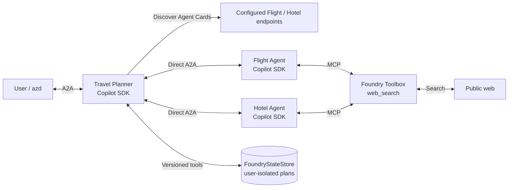
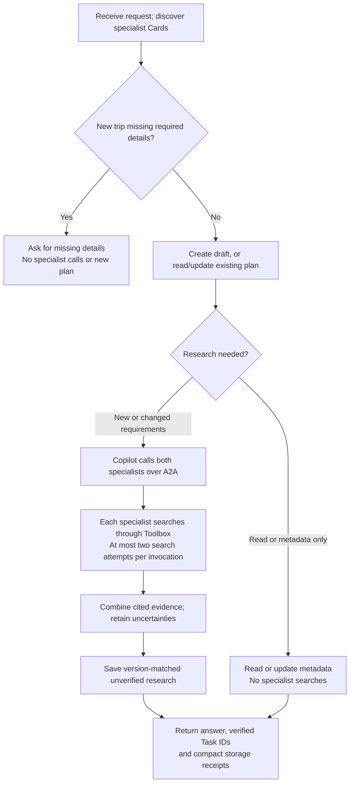

# A2A Bug Bash Guide - Travel Planner with Web Search

Today we will build and deploy a travel planner that collaborates with Flight
and Hotel agents over A2A. The specialists will search the web through a Foundry
Toolbox and return research with source links. We will save a trip, retrieve it
later, change its dates, edit metadata and inspect its history.
Along the way, we will check that the agents actually called their tools and
clearly marked any unverified prices or availability. No bookings will be made.

Start from an empty folder. All setup and bug-bash steps are included here.
Run commands individually from your initialized project folder.

## Architecture in plain terms

### Component block diagram



### Request flow



Each agent has its own Copilot SDK model/tool loop. The planner chooses which
specialist to call; each specialist chooses its search queries. 

**Research is not a booking quote.** Prices, availability, cancellation terms and
distance may remain unverified. Saved results must say **`unverified`**, never
`ready` or `no_match`. There is no predetermined trip total.


### About the filled examples

Placeholder commands have filled examples below them. Our reference deployment:

| Component | Existing reference name | Deployed version |
|---|---|---|
| Flight | `travel-flights-web-nov4` | 2 |
| Hotel | `travel-hotels-web-nov4` | 2 |
| Planner | `travel-planner-web-nov4` | 1 |
| Toolbox | `travel-web-search-nov4` | 1 |

These are **syntax references, not resources to recreate, redeploy or delete**.
Use unique names and your own new Plan ID. The reference plan is user-isolated,
already saved, and **not a shared fresh-test fixture**.

## 1. Check tools, enable A2A and sign in

### Choose the command for your terminal

If your prompt starts with **`PS`**, use **PowerShell**:

```powershell
$env:AZD_ALPHA_ENABLE_AGENTS_A2A = "true"
$env:AZD_ALPHA_ENABLE_AGENTS_A2A
```

For **Command Prompt (`cmd.exe`)** instead:

```cmd
set "AZD_ALPHA_ENABLE_AGENTS_A2A=true"
echo %AZD_ALPHA_ENABLE_AGENTS_A2A%
```

The check should print `true`. Run only the block for your shell; `set` in
PowerShell does not set this environment variable. Repeat the appropriate block
whenever you open a new terminal, and run the remaining commands in that terminal.

### These commands work in either shell

```text
azd version
az version
azd extension install azure.ai.agents --version 1.0.0-beta.23 --source azd
azd auth login
az login
```

If installed, replace the install command with:

```text
azd extension update azure.ai.agents --version 1.0.0-beta.23 --source azd
```

`azure.yaml` declares `gpt-5.4-mini` and selects it for all three agents.
If the model is missing, use the provisioning step below.

## 2. Initialize in an empty folder

Use an authorized project with native A2A enabled by the organizer; the local
flag above does not grant project access or enable the service for a subscription.
Create an empty folder and open your chosen terminal there. In a new terminal,
repeat the matching A2A environment-variable block from Section 1, then use your
project ARM ID:

```text
azd ai agent init --src . -t "https://github.com/Hameedkunkanoor/foundry-samples/blob/feature/a2a-llm-release-planner/samples/python/hosted-agents/bring-your-own/a2a/travel-planner-web-search/azure.yaml" --project-id "<PROJECT-ARM-ID>" -e travel-web-bugbash
```

**Filled example - our project** (confirm access with the organizer):

```text
azd ai agent init --src . -t "https://github.com/Hameedkunkanoor/foundry-samples/blob/feature/a2a-llm-release-planner/samples/python/hosted-agents/bring-your-own/a2a/travel-planner-web-search/azure.yaml" --project-id "/subscriptions/47f1c914-e299-4953-a99d-3e34644cfe1c/resourceGroups/rg-e4ag828a-dev/providers/Microsoft.CognitiveServices/accounts/cog-6v7yi2yjkzt7g/projects/e4ag828a-dev" -e travel-web-bugbash
```

Complete prompts. Edit service-level **name values** in `azure.yaml`:

| Keep service key | Example unique name |
|---|---|
| `flights` | `travel-web-flights-youralias-01` |
| `hotels` | `travel-web-hotels-youralias-01` |
| `planner` | `travel-web-planner-youralias-01` |

**For a clean specialist-permissions test, use brand-new Flight/Hotel names and
identities that have never received runtime role grants.** Redeploying a new
version of an existing agent is not sufficient. Do not copy the existing
reference endpoints below into your deployment; use your new agents' endpoints.


### Provision if you do not have the model

From the initialized folder, run:

```text
azd provision
```

Skip this if the project already has `gpt-5.4-mini`. Provisioning requires the
appropriate permissions and model quota. In the tested existing-project flow,
this command could be a no-op; if it does not create the missing model, ask the
organizer to resolve provisioning before continuing.

## 3. Create or reuse a web-search toolbox

Open downloaded `toolbox.json`. Give it your unique toolbox name; keep its single
tool's **name and type both `web_search`**. No separate Bing resource, API key or
project connection is needed.

```text
azd ai toolbox create <YOUR-TOOLBOX-NAME> --from-file toolbox.json --no-prompt --output json
azd ai toolbox show <YOUR-TOOLBOX-NAME> --output json
```

**Filled example - our existing toolbox.** It already exists: use `show` only;
the `create` line illustrates syntax, not a request to recreate it.

```text
azd ai toolbox create travel-web-search-nov4 --from-file toolbox.json --no-prompt --output json
azd ai toolbox show travel-web-search-nov4 --output json
```

For that create example, the definition's name would also need to be
`travel-web-search-nov4`. Prefer creating your own; reuse a shared toolbox only
with organizer approval.

Copy the actual **pinned version MCP endpoint** from the output:

```text
azd env set TOOLBOX_ENDPOINT "<TOOLBOX-MCP-ENDPOINT>"
```

**Filled example:**

```text
azd env set TOOLBOX_ENDPOINT "https://cog-6v7yi2yjkzt7g.services.ai.azure.com/api/projects/e4ag828a-dev/toolboxes/travel-web-search-nov4/versions/1/mcp?api-version=v1"
```

It must belong to your project, end in `/mcp?api-version=v1`, and expose
`web_search`. Do not use a custom `FOUNDRY_` variable. Both specialists read
`TOOLBOX_ENDPOINT`; the planner does not.

## 4. Deploy and grant runtime access

Deploy Flight and Hotel first:

```text
azd deploy flights --no-prompt
azd deploy hotels --no-prompt
azd ai agent show flights --output json
azd ai agent show hotels --output json
```

Confirm both are active. Copy their **`agent_endpoints.a2a`**:

```text
azd env set FLIGHT_AGENT_ENDPOINT "<FLIGHT-A2A-ENDPOINT>"
azd env set HOTEL_AGENT_ENDPOINT "<HOTEL-A2A-ENDPOINT>"
```

**Filled example - our specialist endpoints:**

```text
azd env set FLIGHT_AGENT_ENDPOINT "https://cog-6v7yi2yjkzt7g.services.ai.azure.com/api/projects/e4ag828a-dev/agents/travel-flights-web-nov4/endpoint/protocols/a2a?api-version=v1"
azd env set HOTEL_AGENT_ENDPOINT "https://cog-6v7yi2yjkzt7g.services.ai.azure.com/api/projects/e4ag828a-dev/agents/travel-hotels-web-nov4/endpoint/protocols/a2a?api-version=v1"
```

Use your own deployed endpoints, not Card/Responses URLs. Then deploy:

```text
azd deploy planner --no-prompt
azd ai agent show planner --output json
```

### Planner runtime access - one-time owner setup, only if missing

The planner's managed identity needs access to Flight/Hotel's protected A2A
endpoints and Cards. Keep this permission even when testing specialist access.
If already configured, skip the grant. Otherwise, give the owner the **planner's**
`instance_identity.principal_id` from its `show` output.
An authorized owner grants **Foundry Agent Consumer** to that planner identity
at project scope only when access is not already configured:

```text
az role assignment create --assignee-object-id "<PLANNER-INSTANCE-PRINCIPAL-ID>" --assignee-principal-type ServicePrincipal --role "Foundry Agent Consumer" --scope "<PROJECT-ARM-ID>"
```

PowerShell can print the planner identity directly:

```powershell
(azd ai agent show planner --output json | ConvertFrom-Json).instance_identity.principal_id
```

Use the project ARM ID passed during init, not the HTTPS project URL.

**Filled example - our planner identity.** This grant already exists;
do not grant again or reuse this identity for your agents.

```text
az role assignment create --assignee-object-id "9a5b7213-6f77-4fd1-b678-2d209d966dfc" --assignee-principal-type ServicePrincipal --role "Foundry Agent Consumer" --scope "/subscriptions/47f1c914-e299-4953-a99d-3e34644cfe1c/resourceGroups/rg-e4ag828a-dev/providers/Microsoft.CognitiveServices/accounts/cog-6v7yi2yjkzt7g/projects/e4ag828a-dev"
```

Review this project-wide grant with the owner, use instance identities rather
than blueprints, and allow RBAC propagation before testing.


### Clean first-run check

1. Keep the **planner's** runtime grant.
2. Do not assign extra Consumer roles to Flight/Hotel for this test. A clean run
   succeeded with brand-new, never-granted specialist identities. Existing user
   deployment access and telemetry-viewing access are separate prerequisites.
3. Run Section 5, then inspect actual successful specialist
   Tasks, `web-search` receipts and the saved `unverified` result.
4. If it fails, save the error, agent identities, Task/Trace IDs and any saved
   Plan ID before changing permissions. Separate Card-discovery failures from
   Toolbox failures; do not treat HTTP 200 alone as success.

## 5. Research and save the first trip

Commands assume a fresh planner **version 1**. Confirm and use your actual
deployed version if different. 

**What the flags mean:** `--version 1` selects deployed agent code; it does not
create a new version. Commands reuse the CLI's agent session by default.
Creating a saved plan is controlled by the request, not by session reuse.
To test storage across fresh hosted sessions separately, you can optionally add
`--new-session`. These commands do not contain a `--new-version` flag.

```text
azd ai agent invoke <PLANNER-AGENT-NAME> -p a2a --a2a-version 1.0 --version 1 --input-file trip-request.json --output default
```

**Filled example - our planner v1** (run where `trip-request.json` is available):

```text
azd ai agent invoke travel-planner-web-nov4 -p a2a --a2a-version 1.0 --version 1 --input-file trip-request.json --output default
```

The request is one traveler, SFO-SEA, January 10-13 2027, a $1,200 total budget,
refundable preferences, and a hotel near **Seattle Convention Center Summit**.
It supplies explicit check-in/check-out dates and a public landmark.
Do not provide private addresses.

**Pass checks:**

- Both Flight and Hotel returned completed A2A Tasks, with actual Task IDs.
- Each specialist invocation attempted at most **two** searches and returned
  at least one successful `web_search` receipt with source URLs.
- The answer includes relevant clickable citations and clearly separates
  exact-date evidence from generic policies or advertised rates.
- Storage acknowledges the new plan and recommendation; final status is
  **`unverified`**. Compact receipts show the plan ID, version, requirements
  revision, status and history count; full records remain in storage.
- Unknown prices/refundability/availability remain unknown. No invented total,
  guaranteed eligible pair or booking claim.

Copy **your new `plan-...` ID** for the tests below. Their filled examples use our
existing `plan-5b753f084fe2439f963eb1c1ef77ab9f`, a syntax reference only.
Do not run write examples against that reference record.

Commands below use `<PLAN-ID>`: replace it with your actual new Plan ID.
If you prefer a variable, the syntax depends on your shell:

```powershell
$planId = "PASTE_YOUR_NEW_PLAN_ID_HERE"
```

In PowerShell, use `$planId` inside the double-quoted prompts.

```cmd
set "PLAN_ID=PASTE_YOUR_NEW_PLAN_ID_HERE"
```

In Command Prompt, use `%PLAN_ID%` inside the prompts instead. Do not mix the
variable syntaxes. Changing the current folder does not change your shell.

## 6. Saved-trip checks

Use the same signed-in user and substitute your own Plan ID.

### Read without changes

```text
azd ai agent invoke <PLANNER-AGENT-NAME> -p a2a --a2a-version 1.0 --version 1 --output default "Show saved plan <PLAN-ID>, including requirements, metadata, version and cited recommendation. Do not change or reprice it and do not call specialists."
```

**Filled example:**

```text
azd ai agent invoke travel-planner-web-nov4 -p a2a --a2a-version 1.0 --version 1 --output default "Show saved plan plan-5b753f084fe2439f963eb1c1ef77ab9f, including requirements, metadata, version and cited recommendation. Do not change or reprice it and do not call specialists."
```

**Check:** same record/version/recommendation, no specialist calls or writes.

### Change dates and refresh both specialists

```text
azd ai agent invoke <PLANNER-AGENT-NAME> -p a2a --a2a-version 1.0 --version 1 --output default "Read plan <PLAN-ID>. Change departure to 2027-01-11, return to 2027-01-14 and arrival deadline to 2027-01-12T09:00:00-08:00. Preserve other requirements and metadata. Save changes, consult both specialists with the revised public requirements and save cited research as unverified."
```

**Filled example:**

```text
azd ai agent invoke travel-planner-web-nov4 -p a2a --a2a-version 1.0 --version 1 --output default "Read plan plan-5b753f084fe2439f963eb1c1ef77ab9f. Change departure to 2027-01-11, return to 2027-01-14 and arrival deadline to 2027-01-12T09:00:00-08:00. Preserve other requirements and metadata. Save changes, consult both specialists with the revised public requirements and save cited research as unverified."
```

**Check:** higher requirements revision, fresh Task IDs and searches, new dates in
both requests and saved research. Old research must not remain current.
The completed result is still `unverified`; a failed refresh stays `needs_replan`.

### Change metadata only

```text
azd ai agent invoke <PLANNER-AGENT-NAME> -p a2a --a2a-version 1.0 --version 1 --output default "Read plan <PLAN-ID>. Update only metadata: purpose business, cost_center CC-99, preferences seat aisle and meal vegetarian. Preserve requirements and recommendation. Save without calling specialists or web search."
```

**Filled example:**

```text
azd ai agent invoke travel-planner-web-nov4 -p a2a --a2a-version 1.0 --version 1 --output default "Read plan plan-5b753f084fe2439f963eb1c1ef77ab9f. Update only metadata: purpose business, cost_center CC-99, preferences seat aisle and meal vegetarian. Preserve requirements and recommendation. Save without calling specialists or web search."
```

**Check:** record version/metadata change, but requirements revision, recommendation
and specialist Task IDs stay unchanged. No specialist searches; Card discovery
GETs may still occur.

### History and listing

```text
azd ai agent invoke <PLANNER-AGENT-NAME> -p a2a --a2a-version 1.0 --version 1 --output default "Show full history for plan <PLAN-ID>, then list my saved plan IDs. Do not modify or reprice any plan and do not call specialists."
```

**Filled example:**

```text
azd ai agent invoke travel-planner-web-nov4 -p a2a --a2a-version 1.0 --version 1 --output default "Show full history for plan plan-5b753f084fe2439f963eb1c1ef77ab9f, then list my saved plan IDs. Do not modify or reprice any plan and do not call specialists."
```

**Check:** creation, old/new research and date/metadata changes remain in history.
Normally five write events after this ordered walkthrough; reads add none.
Listing includes your Plan ID; record version stays unchanged.

## 7. Missing details and failure recovery

### Clarification, not invented requirements

```text
azd ai agent invoke <PLANNER-AGENT-NAME> -p a2a --a2a-version 1.0 --version 1 --output default "Research a trip from SFO to SEA with refundable flights and hotel."
```

**Filled example:**

```text
azd ai agent invoke travel-planner-web-nov4 -p a2a --a2a-version 1.0 --version 1 --output default "Research a trip from SFO to SEA with refundable flights and hotel."
```

**Check:** asks for missing dates, travelers, budget, arrival deadline and public
office landmark/distance. No specialist calls, searches or saved complete plan.

### If a request fails after saving a draft

Do not repeat creation blindly. First use the read command above. If you have no
Plan ID, ask the planner to list your saved IDs without modifying anything.
Once you identify the pending draft, resume it:

```text
azd ai agent invoke <PLANNER-AGENT-NAME> -p a2a --a2a-version 1.0 --version 1 --output default "Read plan <PLAN-ID>. Do not create another plan or change requirements or metadata. Complete pending research by consulting Flight and Hotel once each with the full public requirements, at most two searches each. Save cited research as unverified with the current version."
```

**Filled example - syntax only; use your own pending plan:**

```text
azd ai agent invoke travel-planner-web-nov4 -p a2a --a2a-version 1.0 --version 1 --output default "Read plan plan-5b753f084fe2439f963eb1c1ef77ab9f. Do not create another plan or change requirements or metadata. Complete pending research by consulting Flight and Hotel once each with the full public requirements, at most two searches each. Save cited research as unverified with the current version."
```

**Check:** same Plan ID, no duplicate; completed research saved only after both
specialists succeed. If the refreshed tools fail, report failure and pending state.
Do not automatically increase shared model capacity or bypass version conflicts.

## 8. Inspect saved data directly with azd

These read-only commands do not call the model or specialists.

### Show store settings and list saved plan keys

```text
azd ai agent state-stores show travel-web-research --agent-name planner --output json
azd ai agent state-stores items list --store travel-web-research --agent-name planner --limit 20 --output json
```

### Read a full saved record, including history

```text
azd ai agent state-stores items show <PLAN-ID> --store travel-web-research --agent-name planner --output json
```

**Filled example - an existing plan owned by our test user:**

```text
azd -C C:\a2a\travel-nov4-3 ai agent state-stores items show plan-cc42f6164b7a4ecb8a51cfdbe598adbf --store travel-web-research --agent-name planner --output json
```

Use your own Plan ID and initialized folder. Listing returns keys/metadata with
`value: null`; use `items show` for the actual value and ETag. If `has_more` is
true, pass the returned `last_id` unchanged as `--after` on the next list call.

These reads succeeded in our project, despite extension beta.23 help saying
user-isolated items cannot be read by azd. Access may differ by user/project.
If denied, use the planner's read/list tools with the same signed-in user; do not
disable isolation or pass someone else's call ID. Do not replace/delete items
directly to bypass plan versions, history and research-refresh safeguards.

## 9. Inspect evidence and report bugs

- Choose `--output raw` **before** a test when the complete A2A envelope is needed.
  Planner artifacts are compact in both output modes; raw does not restore full
  plan/history dumps. Do not repeat a write merely to change output format.
- `specialist-calls` lists actual completed tool/agent/Task IDs without repeating
  specialist answers. `trip-state` lists operations and compact plan summaries.
  Inspect web-search activity in traces or the specialist's own response artifacts.
  Request full history explicitly when needed; ordinary reads need only `get_plan`.
  Agent IDs, Task IDs, Plan IDs and record versions are different.
- Open a **planning or date-refresh trace** in Foundry to inspect Flight/Hotel
  and web-search calls. Retrieval, metadata, history and clarification traces
  correctly have no specialist calls; the newest trace may be one of these.
- Verified planning trace `9b773fd486c1ee444cc96b28ea98570e` and date-refresh trace
  `0a0874c10efc24bf8723fd5948190e2f` each contain Planner, Flight, Hotel and four
  `tools/call web_search` spans under the same trace ID, with no failed spans
  in the queried results. Trace `58b2c86514b74bb2ea7bcc4dc985783d` is the
  missing-details clarification test and intentionally contains only the planner.
  Exact UI nesting is not assumed from trace-ID correlation alone.
- Report the prompt, expected/actual result, Plan ID/version, actual Task IDs,
  Trace ID, citations and relevant receipts. Never share credentials, auth headers
  or environment files.

### Cleanup

Delete only agents you created, after saving evidence:

```text
azd ai agent delete <YOUR-PLANNER-NAME>
azd ai agent delete <YOUR-FLIGHT-NAME>
azd ai agent delete <YOUR-HOTEL-NAME>
```

**Filled example - disposable names, not our reference deployment:**

```text
azd ai agent delete travel-web-planner-youralias-01
azd ai agent delete travel-web-flights-youralias-01
azd ai agent delete travel-web-hotels-youralias-01
```

Do not run `azd down` on a shared project or delete shared models, toolboxes,
state stores or role assignments. Coordinate any toolbox/access cleanup with the owner.
